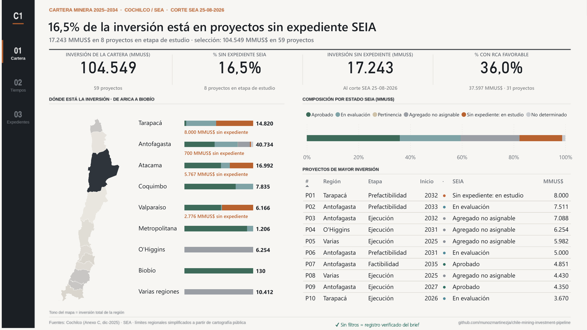
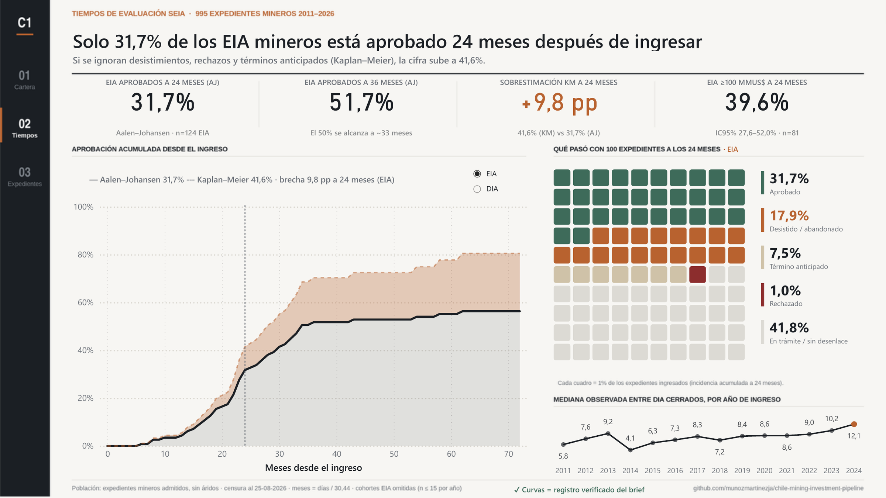
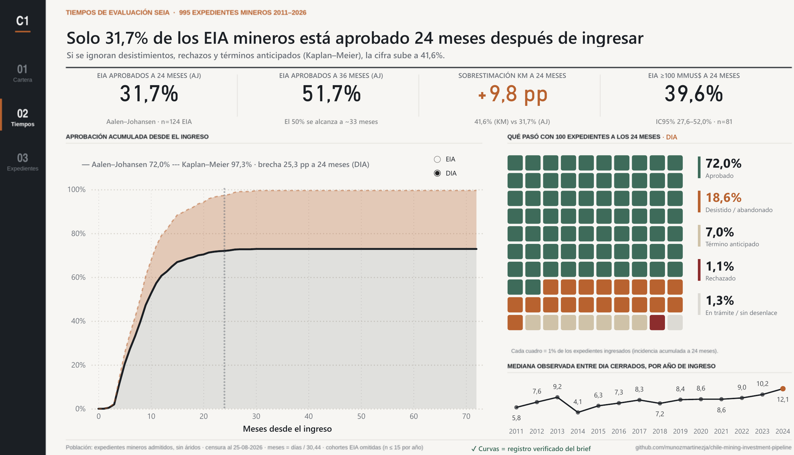
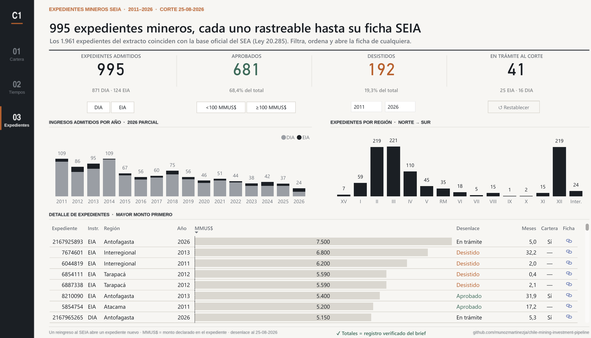
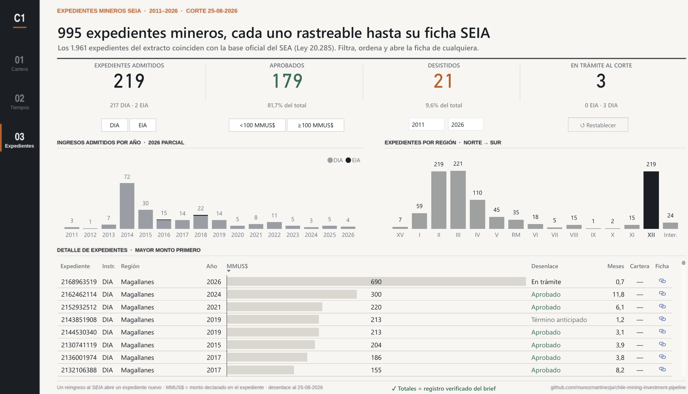
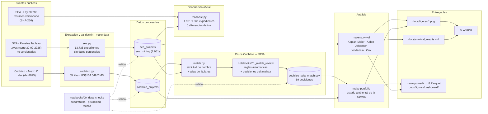
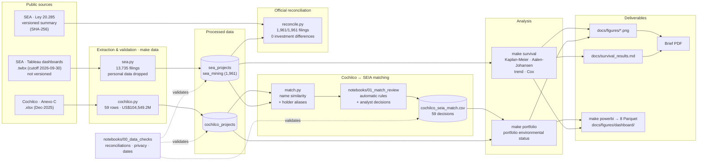

# Chile Mining Investment Pipeline

## Idiomas / Languages

- [Español](#español)
- [English](#english)

---

## Español

CMIP convierte la cartera de inversión minera de Cochilco de diciembre de 2025
en datos reproducibles para analizar los 59 proyectos previstos para 2025–2034
y su tramitación ambiental en el SEIA.



### Hallazgos

**16,5% de la inversión minera 2025–2034 no tiene expediente SEIA
identificado:** 17.243 MMUS$ en 8 proyectos, todos en etapa de estudio.

- La incidencia acumulada de EIA que obtuvo RCA favorable es **31,7% a 24 meses** y
  **51,7% a 36 meses**. Kaplan–Meier arrojaría 41,6% a 24 meses, una
  sobrestimación de 9,8 pp por tratar los desistimientos como censuras simples.
- Para EIA ≥100 MMUS$, la incidencia Aalen–Johansen de RCA favorable a 24 meses es **39,6%**
  (IC 95% bootstrap 27,6%–52,0%; n = 81).
- La inversión actualmente en evaluación alcanza **24.580 MMUS$ en 14
  proyectos**.
- La inversión con RCA favorable suma **37.597 MMUS$ (36,0%)** en 31 proyectos.

Briefs ejecutivos: [español](docs/brief/brief_c1_es.pdf) ·
[English](docs/brief/brief_c1_en.pdf).

Sensibilidades fuera del PDF (DIA / EIA respectivamente):

| Población | n | Aprobación AJ a 24 meses |
|---|---:|---:|
| Principal, sin expedientes de áridos | 871 / 124 | 72,0% / 31,7% |
| Con áridos y registros no mineros `i5*` | 1.515 / 130 | 66,5% / 31,3% |
| Sin desistimientos a 60 días o menos | 764 / 112 | 82,1% / 35,2% |
| Reingresos deduplicados | 765 / 107 | 79,0% / 32,8% |

Con el último ingreso de cada una de las 872 familias, la referencia EIA es
32,8% a 24 meses y 56,2% a 36 meses. En la población principal quedan en
riesgo 40/17 EIA y 10/1 DIA a 24/36 meses. Para las estimaciones principales
(31,7% y 51,7% EIA; 72,0% DIA), los IC 95% bootstrap por familia de reingreso
son 22,4%–41,4% (EIA 24 meses), 41,7%–62,4% (EIA 36 meses) y 69,0%–75,0%
(DIA 24 meses).

Como sensibilidad del cruce automático a umbral 90, queda sin cruce 9,72% de
la inversión con alias y 20,72% sin alias. El escenario publicado sigue siendo
la decisión curada del autor, no una medición única del algoritmo.

### Dashboard (Power BI)

**Página 1 — Cartera:** dónde está la inversión y cuál es su estado SEIA
(imagen al inicio).

---

**Página 2 — Tiempos:** brecha Kaplan–Meier vs. Aalen–Johansen y desenlaces a
24 meses por instrumento.



<details>
<summary>Vista DIA</summary>


</details>

---

**Página 3 — Expedientes:** explorador de expedientes SEIA con enlace a la
ficha de cada uno.



<details>
<summary>Filtro por región: Magallanes</summary>


</details>

Cada página compara sus totales con el registro verificado y muestra ✔ solo si
coinciden.

### Método y validación

La compuerta de publicación exige que cada cifra figure en el registro de
`build_claims_register()` con estado `verificada`. Cada cifra publicada pasa
por un control programático; el registro declara para cada una si su recálculo
es independiente, un control aritmético o una réplica. En C1 son 30, 71 y 10;
en C1-ML, 9, 15 y 17, respectivamente.
El checklist contiene 61 obligaciones completas (40 comprobaciones iniciales y
21 asignaciones automáticas confirmadas) y 59 decisiones documentadas.
`make brief DRAFT=1` genera PDF con marca de agua; `make brief` requiere que la
compuerta esté superada.

**Conciliación con la base oficial del SEA (Ley 20.285):** 1.961/1.961
expedientes concuerdan; 0 diferencias de instrumento, tipología o inversión.
Hay 2 diferencias en la fecha de ingreso. El resumen versionado (con hash
SHA-256) es una atestación: el CSV oficial, obtenido por Ley 20.285, no se
redistribuye.
Detalle: [`docs/reconciliation_sea_oficial.md`](docs/reconciliation_sea_oficial.md).

### Fuentes

La fuente de cartera es la Comisión Chilena del Cobre (Cochilco), *Cartera de
Proyectos de Inversión Minera en Chile 2025–2034*, Anexo C, diciembre de 2025.
Los expedientes ambientales provienen de los paneles públicos del Servicio de
Evaluación Ambiental (SEA). El último registro observado es del 25-08-2026,
fecha usada para censurar casos abiertos. La conciliación oficial se realizó
con la respuesta del SEA a la Ley de Transparencia del 13-10-2026. Las URL,
nombres de archivos y sumas de verificación están en
[`data/raw/SOURCES.md`](data/raw/SOURCES.md).

### Arquitectura del pipeline



### Notebooks

- [`notebooks/00_data_checks.ipynb`](notebooks/00_data_checks.ipynb): cuadratura
  de 104.549,2 MMUS$, conteos SEA, privacidad y completitud de fechas.
- [`notebooks/01_match_review.ipynb`](notebooks/01_match_review.ipynb): reglas
  automáticas, revisión de alias, top-3 de casos dudosos, decisiones del analista
  y escritura de `match_confirmado`, `criterio` e `historial`.

### Reproducibilidad

Se requieren Python 3.12 y [`uv`](https://docs.astral.sh/uv/). `make test`
corre sin datos fuente: las pruebas unitarias usan fixtures sintéticos y las
pruebas de integración que requieren Parquet locales se omiten.

Para regenerar las cifras, descargue los dos
libros SEA `.twbx` indicados en `data/raw/SOURCES.md` y guárdelos como:

- `data/raw/sea/sea_proyectos_ingresados.twbx`
- `data/raw/sea/sea_plazos_tramitacion.twbx`

Luego ejecute:

```bash
make setup
make setup-extract
make data analysis validation ml
```

Para trabajar con los notebooks, instale el extra opcional:

```bash
uv pip install --python .venv/bin/python -e '.[notebooks]'
```

`make survival` usa solo datos SEA y genera el análisis de supervivencia y las
figuras 1, 2 y 4. No depende del cruce Cochilco–SEA.

Abra `notebooks/01_match_review.ipynb`, revise primero `ALIAS_REVISADOS`, complete
luego `DECISIONES_ANALISTA` y ejecute todo el notebook. Antes de guardar o
versionar, limpie todos los outputs: pueden contener nombres del archivo local
y `make test` exige que los `.ipynb` versionados no almacenen outputs. Cuando
existan 59 decisiones, ejecute:

```bash
make portfolio
```

`make portfolio` genera el estado ambiental de la cartera y la figura 3; es el
único componente que depende de las 59 decisiones. `make analysis` ejecuta
serialmente `survival` y luego `portfolio`: si faltan decisiones, conserva la
salida SEA y retorna error al llegar al componente de cartera.

```bash
make analysis
make test
make lint
```

### Power BI

Ejecute `make powerbi` para generar ocho Parquet livianos y con esquema
explícito en `data/powerbi/`:

- `fact_cartera.parquet`
- `fact_expedientes.parquet`
- `agg_km.parquet`
- `agg_cif.parquet`
- `agg_tendencia.parquet`
- `agg_brecha_km_aj.parquet`
- `agg_waffle_24m.parquet`
- `kpi_validados.parquet`

En Power BI Desktop, use **Obtener datos → Parquet** para cargar cada archivo
y mantenga el locale del archivo en `es-CL`. El modelo y las medidas no se
distribuyen como `.pbix`. Las capturas de pantalla del dashboard están en
`docs/figures/dashboard/`.

Los Parquet son artefactos locales ignorados por Git. `docs/match_review.csv`
permanece local porque contiene nombres. El único cruce versionado es
`data/curated/cochilco_seia_match.csv`, con las columnas `cochilco_id`,
`exp_id_confirmado`, `criterio` e `historial`. El catálogo
`data/curated/company_aliases.csv` registra la revisión de sociedades titulares.

Los `.twbx`, Parquet intermedios/procesados y bases DuckDB son artefactos
locales. Los Parquet no se versionan y se regeneran con `make data analysis
validation ml`. La base oficial SEA obtenida por Ley 20.285 no se redistribuye;
solo se versiona su resumen con hash SHA-256. Por ello, el repositorio sin las
fuentes locales no reproduce por sí solo las cifras publicadas.

### Autoría y decisiones del analista

Código desarrollado con asistencia de herramientas de IA. Pregunta, criterios,
decisiones sobre los datos y validación: del autor.

El registro documenta 59 decisiones curadas, 2 excepciones compartidas y 15
alias con evidencia. Sus fuentes versionadas son
`data/curated/cochilco_seia_match.csv`,
`data/curated/shared_expediente_exceptions.csv` y
`data/curated/company_aliases.csv`.

### Modelo predictivo (C1-ML)

¿Con lo conocido al ingreso, se puede anticipar si se obtiene RCA favorable a 24 meses?
En validación rolling-origin por año de ingreso, M2c alcanza un ROC AUC de **0,737** dentro de las DIA, donde la tasa histórica por instrumento no ordena (es constante); en el total, **0,733** frente a 0,612 de la línea base, y Brier **0,198** frente a 0,213.
En el análisis exploratorio de M2, retirar el bloque del titular reduce el ROC AUC de 0,745 a 0,649. La diferencia de Brier frente a B0 depende del esquema de remuestreo (por expediente, el IC incluye cero; por año, lo excluye), así que no se afirma una mejora en probabilidades.
En EIA el modelo no discrimina (ROC AUC **0,449**; 45 expedientes de prueba): no debe usarse para ese instrumento.
Ver [docs/ml_results.md](docs/ml_results.md).

### Licencia

El código se distribuye bajo licencia MIT. Los datos fuente conservan las
condiciones de sus respectivos publicadores.

---

## English

CMIP turns Cochilco's December 2025 mining-investment portfolio into
reproducible data for analyzing the 59 projects planned for 2025–2034 and
their environmental-review outcomes in the SEIA.


### Findings

**16.5% of 2025–2034 mining investment has no identified SEIA filing:**
US$17,243m across 8 projects, all at study stage.

- The cumulative incidence of EIAs obtaining a favourable RCA is **31.7% at 24 months** and **51.7%
  at 36 months**. Kaplan–Meier would yield 41.6% at 24 months — an
  overestimate of 9.8 pp from treating withdrawals as simple censoring.
- For EIAs ≥US$100m, 24-month Aalen–Johansen favourable-RCA incidence is **39.6%**
  (95% bootstrap CI 27.6%–52.0%; n = 81).
- Investment currently under review totals **US$24,580m across 14 projects**.
- Investment with a favourable RCA totals **US$37,597m (36.0%)** across 31
  projects.

Executive briefs: [Español](docs/brief/brief_c1_es.pdf) ·
[English](docs/brief/brief_c1_en.pdf).

Sensitivity results excluded from the PDF (DIA / EIA, respectively):

| Population | n | 24-month AJ approval |
|---|---:|---:|
| Main population, excluding sand-and-gravel filings | 871 / 124 | 72.0% / 31.7% |
| Including aggregates and non-mining `i5*` records | 1,515 / 130 | 66.5% / 31.3% |
| Excluding withdrawals at 60 days or earlier | 764 / 112 | 82.1% / 35.2% |
| Deduplicated re-entries | 765 / 107 | 79.0% / 32.8% |

Keeping the last filing in each of 872 families gives descriptive EIA
references of 32.8% at 24 months and 56.2% at 36 months. In the main
population, 40/17 EIAs and 10/1 DIAs remain at risk at 24/36 months. For the
main estimates (31.7% and 51.7% EIA; 72.0% DIA), the re-entry-family bootstrap
95% CIs are 22.4%–41.4% (EIA, 24 months), 41.7%–62.4% (EIA,
36 months), and 69.0%–75.0% (DIA, 24 months).

At an automatic-match threshold of 90, 9.72% of investment remains unmatched
with aliases and 20.72% without aliases. The published scenario is the
author-curated decision, not a single algorithmic measurement.

### Dashboard (Power BI)

**Page 1 — Portfolio:** where the investment sits and what SEIA status each
project holds (image at the top).

---

**Page 2 — Timelines:** Kaplan–Meier vs. Aalen–Johansen gap and 24-month
outcomes by instrument type.


<details>
<summary>DIA view</summary>


</details>

---

**Page 3 — Filings:** SEIA filing explorer with a direct link to each
filing's record page.


<details>
<summary>Filter by region: Magallanes</summary>


</details>

Each page compares its totals against the verified register and shows ✔ only
when they match.

### Method and validation

The publication gate requires every figure to appear in
`build_claims_register()` with status `verificada`. Every published figure
passes a programmatic control; the register labels each recalculation as
independent, arithmetic control, or replica. C1 contains 30, 71, and 10;
C1-ML contains 9, 15, and 17, respectively. The checklist contains 61 completed entries (40 initial checks
and 21 confirmed automatic assignments) and 59 documented analyst decisions.
`make brief DRAFT=1` creates watermarked review PDFs; `make brief` requires
the gate to be passed.

**Reconciliation against the official SEA dataset (Ley 20.285):** 1,961/1,961
filings match; 0 differences in instrument, typology, or investment amount.
There are 2 differences in filing date. The versioned summary (with SHA-256
hash) is an attestation: the official CSV obtained under Ley 20.285 is not
redistributed.
Details: [`docs/reconciliation_sea_oficial.md`](docs/reconciliation_sea_oficial.md).

### Sources

The portfolio source is the Chilean Copper Commission (Cochilco), *Mining
Investment Project Portfolio in Chile 2025–2034*, Annex C, December 2025.
Environmental filings come from Chile's Environmental Assessment Service (SEA)
public dashboards. The latest observed record is 2026-08-25, which is the
censoring date for open cases. The official reconciliation was performed using
the SEA's response under the Transparency Act of 13 October 2026. URLs, file
names, and checksums are recorded in [`data/raw/SOURCES.md`](data/raw/SOURCES.md).

### Pipeline architecture



Survival analysis (`make survival`) uses SEA data only; portfolio status
(`make portfolio`) requires all 59 match decisions.

### Notebooks

- [`notebooks/00_data_checks.ipynb`](notebooks/00_data_checks.ipynb): validates
  the USD 104,549.2 million total, SEA counts, privacy, and date completeness.
- [`notebooks/01_match_review.ipynb`](notebooks/01_match_review.ipynb): applies
  automatic rules, reviews company aliases, shows the top three candidates for
  uncertain cases, records analyst decisions, and writes `match_confirmado`,
  `criterio`, and `historial`.

### Reproducibility

Python 3.12 and [`uv`](https://docs.astral.sh/uv/) are required. `make test`
runs without source data: unit tests use synthetic fixtures and integration
tests requiring local Parquet files are skipped.

To regenerate the figures, download the two
SEA `.twbx` workbooks listed in `data/raw/SOURCES.md` and save them as:

- `data/raw/sea/sea_proyectos_ingresados.twbx`
- `data/raw/sea/sea_plazos_tramitacion.twbx`

Then run:

```bash
make setup
make setup-extract
make data analysis validation ml
```

Install the optional notebook environment with:

```bash
uv pip install --python .venv/bin/python -e '.[notebooks]'
```

`make survival` uses SEA data only and produces the survival analysis plus
figures 1, 2, and 4. It does not depend on the Cochilco–SEA match.

Open `notebooks/01_match_review.ipynb`, review `ALIAS_REVISADOS` first, then
complete `DECISIONES_ANALISTA` and run the notebook. Clear all notebook outputs
before saving or committing: they may contain names from the local file, and
`make test` requires tracked notebooks to store no outputs. Once all 59
decisions exist, run:

```bash
make portfolio
```

`make portfolio` produces the portfolio environmental status and figure 3; it
is the only component that depends on all 59 decisions. `make analysis` runs
`survival` and then `portfolio` serially: if decisions are missing, it preserves
the SEA outputs and returns an error when it reaches the portfolio component.

```bash
make analysis
make test
make lint
```

### Power BI

Run `make powerbi` to generate eight compact, explicitly typed Parquet files in
`data/powerbi/`:

- `fact_cartera.parquet`
- `fact_expedientes.parquet`
- `agg_km.parquet`
- `agg_cif.parquet`
- `agg_tendencia.parquet`
- `agg_brecha_km_aj.parquet`
- `agg_waffle_24m.parquet`
- `kpi_validados.parquet`

In Power BI Desktop, use **Get data → Parquet** to load each file and keep the
file locale set to `es-CL`. The model and DAX measures are not distributed as
a `.pbix` file. Dashboard screenshots are in `docs/figures/dashboard/`.

The Parquet files are local artifacts ignored by Git. `docs/match_review.csv`
stays local because it contains names. The only versioned crosswalk is
`data/curated/cochilco_seia_match.csv`, containing `cochilco_id`,
`exp_id_confirmado`, `criterio`, and `historial`. The
`data/curated/company_aliases.csv` catalog records company-name review status.

The `.twbx` files, intermediate/processed Parquet files, and DuckDB databases
are local artifacts. Parquet files are not versioned and are regenerated with
`make data analysis validation ml`. The official SEA dataset obtained under
Ley 20.285 is not redistributed; only its SHA-256-attested summary is
versioned. The repository alone therefore does not reproduce the published
figures without the local sources.

### Authorship and analyst decisions

Code developed with AI-assisted tooling. Question, criteria, data decisions
and validation: the author's.

The register documents 59 curated decisions, 2 shared exceptions, and 15
aliases with evidence. Their versioned sources are
`data/curated/cochilco_seia_match.csv`,
`data/curated/shared_expediente_exceptions.csv`, and
`data/curated/company_aliases.csv`.

### Predictive model (C1-ML)

Can a favourable RCA within 24 months be anticipated from information available at intake?
Under rolling-origin year-by-year validation, M2c reaches a ROC AUC of **0.737** within DIA, where the per-instrument historical rate cannot rank (it is constant); overall, **0.733** versus 0.612 for the baseline, and Brier **0.198** versus 0.213.
In the exploratory M2 analysis, removing the applicant-history block lowers ROC AUC from 0.745 to 0.649. The Brier difference versus B0 depends on the resampling scheme (the filing-level CI includes zero; the year-level CI excludes it), so no improvement in probabilities is claimed.
For EIA the model does not discriminate (ROC AUC **0.449**; 45 test filings): it should not be used for that instrument.
See [docs/ml_results.md](docs/ml_results.md).

### License

The code is available under the MIT License. Source data remain subject to
their publishers' terms.
